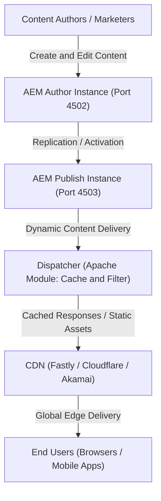
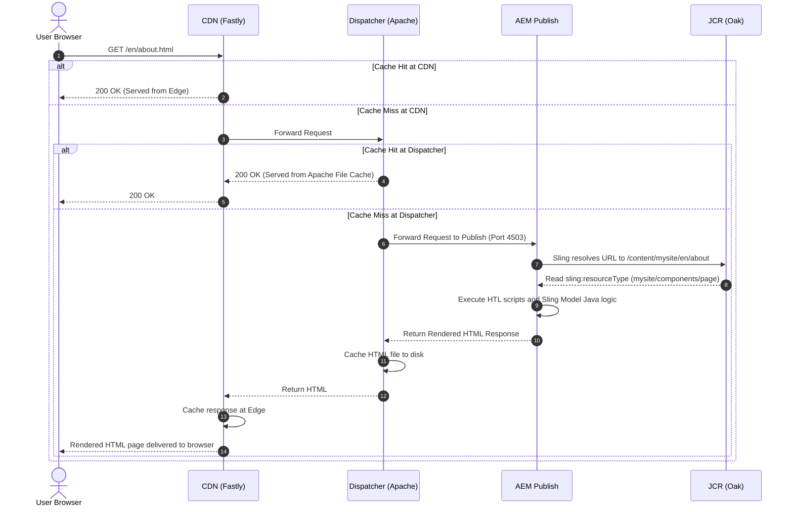

# Adobe Experience Manager (AEM): From Zero to Hero

A comprehensive, step-by-step reference guide to mastering Adobe Experience Manager (AEM).

---

## Learning Roadmap: 12 Modules

| # | Module | Core Learning Objectives |
|---|---|---|
| **1** | **Introduction & The Big Picture** | What AEM is, why enterprises use it, product suite, versions, and deployment models |
| **2** | **System Architecture** | Author, Publish, Dispatcher, CDN, and end-to-end request/content flow |
| **3** | **Core Technologies** | Deep dive into JCR / Oak, Apache Sling, OSGi (Apache Felix), and HTL (Sightly) |
| **4** | **Repository Structure** | Anatomy of `/content`, `/apps`, `/libs`, `/conf`, `/var`, `/home` |
| **5** | **Sites Development** | Components, Editable Templates, Policies, Dialogs (Coral / Granite UI), Sling Models, and Client Libraries |
| **6** | **Content Reuse & Governance** | Core Components, Content Fragments (CFs), and Experience Fragments (XFs) |
| **7** | **AEM Assets (DAM)** | Asset ingestion, metadata schemas, renditions, processing profiles, and Dynamic Media |
| **8** | **Dispatcher & Caching** | Dispatcher caching rules, security filters, virtual hosts, vanity URLs, and cache invalidation |
| **9** | **Workflows, Replication & Security** | Custom workflows, replication agents / Sling Content Distribution (SCD), users, groups, and ACLs |
| **10** | **Project Setup & DevOps** | AEM Maven Archetype, project module structure, Cloud Manager CI/CD pipelines |
| **11** | **Headless & Modern AEM** | GraphQL APIs, Single Page Application (SPA) Editor, and Edge Delivery Services (EDS) |
| **12** | **Advanced Topics & Best Practices** | Multi-Site Manager (MSM), Internationalization (i18n), Launches, Oak search indexing, performance optimization, and interview preparation |

---

# Module 1: Introduction & The Big Picture

## 1.1 What is AEM?

**Adobe Experience Manager (AEM)** is an enterprise-grade Content Management System (CMS) and digital experience platform built to help global enterprises manage high-traffic websites, mobile applications, digital marketing assets (images, videos, audio), and online forms across multiple touchpoints.

### Real-World Analogy
Consider a global enterprise such as Nike or Apple:
- They maintain websites across 50+ countries.
- They serve tens of thousands of pages translated into dozens of local languages.
- They manage millions of high-resolution digital assets.

If front-end developers had to manually edit HTML files for every marketing copy update or regional promotion, the release cycle would collapse. AEM solves this problem by cleanly decoupling duties:

- **Content Authors / Marketers**: Create, preview, and publish content without writing any code.
- **Developers**: Build reusable building blocks (components, templates, and backend business logic).
- **System Administrators & DevOps**: Control security, access permissions, CI/CD pipelines, and scalability.
- **End Users**: Receive fast, cached, personalized, and secure digital experiences.

---

## 1.2 Key Business & Technical Benefits

1. **Intuitive Drag-and-Drop Authoring**: Non-technical team members can create and structure pages visually using the Touch-optimized UI.
2. **Component Reusability**: A single component (e.g., Teaser, Carousel, Accordion) can be reused across thousands of pages with different configurations.
3. **Multi-Site & Multi-Language Governance**: Built-in **Multi-Site Manager (MSM)** and **Language Copy** tools make global rollout and localization straightforward.
4. **Enterprise Approval Workflows**: Content must pass configured review and sign-off workflows before reaching the live site.
5. **Centralized Digital Asset Management (DAM)**: Central storage for all creative assets with automated metadata extraction, smart tagging, and multi-format renditions.
6. **Native Personalization**: Tight integration with Adobe Target allows targeting content to specific audience segments in real time.
7. **Omnichannel & Headless Delivery**: Serve the exact same content to traditional web pages, mobile apps, single-page apps (React/Angular), and in-store displays via REST or GraphQL.
8. **Adobe Experience Cloud Integration**: Turnkey compatibility with Adobe Analytics, Adobe Target, Adobe Campaign, and Adobe Experience Platform (Tags / Launch).

---

## 1.3 The AEM Product Family

AEM is not a single product; it is a suite of integrated enterprise applications:

- **AEM Sites**: The core web content management platform used to create, organize, and deliver websites and headless experiences.
- **AEM Assets**: An enterprise Digital Asset Management (DAM) system that manages the lifecycle of creative files (images, 3D files, videos, documents).
- **AEM Forms**: A solution for creating responsive digital forms, document workflows, and automated communications (e.g., generating bank statements).
- **AEM Screens**: A digital signage management system for driving interactive kiosk and retail screen displays.
- **AEM Guides**: A Component Content Management System (CCMS) for managing technical documentation adhering to DITA standards.
- **Edge Delivery Services (EDS)**: Adobe's next-generation, high-performance publishing engine supporting document-based authoring (directly from Google Docs or Microsoft SharePoint) with near-instant Lighthouse 100 performance.

---

## 1.4 AEM Versions & Deployment Models

| Deployment Model | Description & Key Characteristics |
|---|---|
| **AEM as a Cloud Service (AEMaaCS)** | **The current and future industry standard.** Fully hosted and managed by Adobe in cloud containers. Features automatic zero-downtime scaling, continuous updates, and mandatory deployment via Cloud Manager CI/CD pipelines. |
| **AEM 6.5 / 6.5 LTS (On-Premise)** | Traditional model where an enterprise runs AEM on its own infrastructure or private cloud (AWS/Azure/GCP) using standalone Java `.jar` runtime files. Requires manual service pack upgrades. |
| **Adobe Managed Services (AMS)** | Hybrid model where Adobe hosts traditional AEM 6.5-style virtual instances on dedicated cloud infrastructure on behalf of the client. |

> **Note:** Understanding AEM 6.5 fundamentals remains very useful for understanding foundational concepts, but new commercial projects primarily target **AEM as a Cloud Service**.

---

## 1.5 Roles and Responsibilities in an AEM Project

- **Content Author**: Edits marketing copy, uploads assets, assembles pages, and requests content publication.
- **Template Author / Power Author**: Builds editable page templates, defines structure, and configures component policies without developer intervention.
- **Developer (Frontend / Backend)**: Develops HTL components, dialogs, client libraries (CSS/JS), Sling Models, OSGi services, and backend integrations.
- **AEM Administrator**: Manages user accounts, user groups, permissions (Access Control Lists), OSGi system configurations, and maintenance tasks.
- **DevOps Engineer**: Configures Cloud Manager deployment pipelines, Dispatcher rules, Git branching strategies, and monitoring.

---

# Module 2: System Architecture

## 2.1 High-Level Architecture Flow



---

## 2.2 Author Instance

- **Role**: The authoring environment where marketing teams, copywriters, and content authors log in to create, edit, and organize content.
- **Access**: Strictly internal; requires authentication. Never directly exposed to the general public.
- **Default Local URL**: `http://localhost:4502`
- **Cloud URL Pattern**: `https://author-p<programId>-e<environmentId>.adobeaemcloud.com`
- **Primary Tooling**:
  - **Sites Console**: Page hierarchy and site tree management.
  - **Assets Console**: Media library and metadata management.
  - **Page Editor / Universal Editor**: Visual in-context drag-and-drop authoring.
  - **Workflows Console**: Content review and sign-off processes.

---

## 2.3 Publish Instance

- **Role**: The delivery runtime hosting the approved, live content that is served to end users.
- **Access**: Publicly accessible indirectly via the Dispatcher and CDN. Standard website visitors access content anonymously.
- **Default Local URL**: `http://localhost:4503`
- **Characteristics**:
  - Read-only for visitors (no content authoring interfaces enabled).
  - Scalable: In production (especially AEMaaCS), multiple Publish instances run in parallel behind a load balancer and auto-scale dynamically with traffic surges.

---

## 2.4 Replication (Activation & Publishing)

Replication is the mechanism by which content moves from the **Author** environment to the **Publish** environment:

1. **Activation (Publishing)**: An author reviews a page or asset and triggers the **Publish** action.
2. **Packaging & Transport**:
   - In **AEM 6.5**: Handled by traditional Replication Agents via HTTP POST.
   - In **AEMaaCS**: Handled by **Sling Content Distribution (SCD)** through a durable Adobe Pipeline queue.
3. **Receipt**: The target Publish instance receives the content package and commits the nodes into its local JCR repository.
4. **Cache Flushing**: A replication agent or event triggers a flush request to the Dispatcher to invalidate stale cached HTML pages.
5. **Unpublishing (Deactivation)**: Removes published content from the live Publish instances and flushes the corresponding Dispatcher cache.

---

## 2.5 The Dispatcher

The Dispatcher is Adobe's proprietary module for the **Apache HTTP Server** (or Microsoft IIS). It sits directly in front of the Publish instance and fulfills two critical responsibilities:

1. **Caching (High Performance)**:
   - Caches static assets and rendered HTML pages locally on the web server's file system.
   - When a user requests a cached page, Apache returns it instantly without sending the request to the Publish instance (reducing server load by over 90%).
2. **Security & URL Filtering**:
   - Acts as a protective barrier.
   - Restricts access to internal administrative consoles (e.g., `/crx/de`, `/system/console`).
   - Only explicitly whitelisted URLs, extensions, and query parameters pass through to the Publish instance.
3. **Load Balancing**:
   - Distributes incoming user requests evenly across multiple Publish instances in a farm.

---

## 2.6 Content Delivery Network (CDN)

A **Content Delivery Network (CDN)** is a geographically distributed network of proxy servers that caches web content close to end users:

- **Built-in Cloud CDN**: AEM as a Cloud Service includes a pre-configured CDN powered by **Fastly**.
- **Edge Caching**: Static assets (CSS, JS, images, videos) and cacheable HTML pages are served from edge locations closest to the visitor, drastically reducing latency.
- **Bring Your Own CDN (BYOCDN)**: Enterprises can route traffic through their own CDN providers (e.g., Cloudflare, Akamai) upstream of Adobe's CDN.

---

## 2.7 Internal Technology Stack

AEM is built on top of a mature, enterprise Java stack comprising four primary foundational layers:

```
┌────────────────────────────────────────────────────────┐
│     AEM Application (Sites, Assets, Forms, etc.)       │
├────────────────────────────────────────────────────────┤
│           HTL (HTML Template Language / Sightly)       │
├────────────────────────────────────────────────────────┤
│           Apache Sling (RESTful Web Framework)         │
├────────────────────────────────────────────────────────┤
│       Apache Jackrabbit Oak (Java Content Repository)  │
├────────────────────────────────────────────────────────┤
│               OSGi (Apache Felix Framework)            │
├────────────────────────────────────────────────────────┤
│             Java Virtual Machine (JVM / JDK)           │
└────────────────────────────────────────────────────────┘
```

### Layer Breakdown:

1. **OSGi (Apache Felix)**:
   - A modular system and service platform for Java.
   - Breaks application code into independent, versioned **bundles** (`.jar` files).
   - Allows installing, updating, starting, and stopping individual services at runtime without restarting the JVM.

2. **JCR / Apache Jackrabbit Oak (Content Repository)**:
   - The NoSQL database foundation of AEM.
   - Implements the JCR standard (JSR-283).
   - Stores all content, configuration, assets, and code hierarchically as **nodes** with **properties**, similar to an advanced, searchable file system.

3. **Apache Sling (Web Framework)**:
   - A RESTful, resource-oriented web framework.
   - Maps incoming request URLs directly to JCR repository nodes (Resources).
   - Uses the resource's `sling:resourceType` property to resolve the corresponding rendering script (HTL, JSP) or Java servlet.

4. **HTL (HTML Template Language / Sightly)**:
   - A secure, clean templating language designed specifically for AEM components.
   - Enforces the separation of presentation logic from Java business code.
   - Automatically applies contextual cross-site scripting (XSS) protection.

---

## 2.8 The End-to-End Request Journey

Trace what happens when an end user visits:
`https://www.mysite.com/en/about.html`



### Step-by-Step Breakdown:
1. **User Request**: The browser requests `https://www.mysite.com/en/about.html`.
2. **CDN Inspection**: The CDN checks its edge cache. If cached, it returns the page immediately.
3. **Dispatcher Evaluation**: On a CDN miss, the request hits the Dispatcher. The Dispatcher evaluates security filters; if valid, it checks its local file-system cache.
4. **Publish Instance Execution**: On a Dispatcher miss, the request forwards to the Publish instance.
5. **Sling Resource Resolution**: Apache Sling decomposes the URL:
   - **Path**: `/content/mysite/en/about`
   - **Extension**: `html`
   - Sling finds the node at that path in the JCR repository and reads its `sling:resourceType` (e.g., `mysite/components/page`).
6. **Rendering**:
   - Sling calls the component's rendering script (`page.html` via HTL).
   - Component business logic executes via **Sling Models** (Java POJOs).
   - Child components (Header, Teaser, Footer) are rendered recursively.
7. **Response & Cache Population**: The generated HTML travels back through the Dispatcher (which writes a copy to disk cache) and the CDN (which caches at edge servers) before rendering in the user's browser. Subsequent requests for this page are served directly from cache.

---

## 2.9 Architectural Comparison: AEM Cloud Service vs. AEM 6.5 (On-Premise)

| Architectural Dimension | AEM 6.5 (On-Premise / AMS) | AEM as a Cloud Service (AEMaaCS) |
|---|---|---|
| **Instance Topography** | Fixed, static virtual machines (Author + Publish + Dispatcher). | Dynamic, containerized pods running in Kubernetes (Adobe managed). |
| **Scaling** | Manual scaling or custom cloud scripts; takes time to provision new nodes. | Automatic horizontal scaling based on live traffic volume. |
| **System Updates** | Manual installation of Service Packs, Cumulative Fix Packs, and major upgrades. | Continuous, automated updates rolled out seamlessly by Adobe. |
| **Code Deployments** | Ad-hoc deployment via CRX Package Manager, Jenkins, or custom pipelines. | Strictly enforced via **Adobe Cloud Manager** CI/CD quality gates. |
| **Repository Storage** | TarMK (local disk) or MongoMK. | Cloud-native storage: Azure Blob / AWS S3 for binary assets, managed MongoDB/DocumentDB for node metadata. |
| **CDN Layer** | Requires manual external provisioning and configuration. | Out-of-the-box managed CDN (Fastly) built in by default. |
| **Repository Mutability** | `/apps` and `/libs` are mutable at runtime via CRXDE Lite. | **Immutable repository**: `/apps` and `/libs` are read-only at runtime; changes are only possible via Git deployments. |

---

## Module Summary & Key Takeaways

- **Core Definition**: AEM is an enterprise CMS and DAM designed for large-scale, omnichannel content management and delivery.
- **Topology**:
  - **Author**: Where content is created, edited, and approved.
  - **Publish**: Where live content is rendered for end consumers.
  - **Dispatcher**: Sits in front of Publish for high-speed file caching and URL security filtering.
  - **CDN**: Edge network ensuring minimal latency across global geographies.
- **Internal Stack**: Java JVM → OSGi (modularity) → JCR/Oak (hierarchical storage) → Apache Sling (URL-to-resource mapping) → HTL (secure templating).
- **Modern Standard**: **AEM as a Cloud Service (AEMaaCS)** is the cloud-native, auto-scaling, auto-updating enterprise standard.

