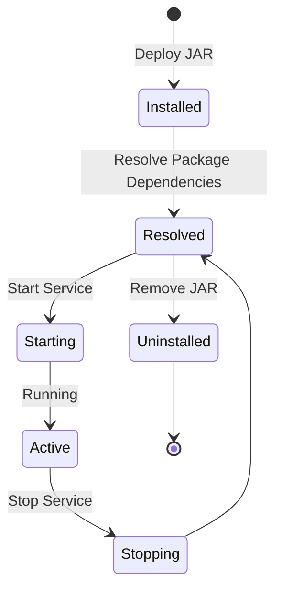
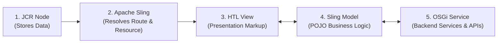

# Module 2: Core Architecture & Technologies

> This module forms the foundational backbone of AEM development. Mastering these four core building blocks will make understanding components, editable templates, dialogs, and workflows seamless.

### Core Architectural Pillars in a Nutshell:
- **JCR / Apache Jackrabbit Oak**: *Content Repository* &mdash; Where and how content is stored hierarchically.
- **Apache Sling**: *Web Framework* &mdash; Maps incoming HTTP request URLs to repository resources and renders them.
- **OSGi (Apache Felix)**: *Modular Runtime* &mdash; Manages modular Java bundles, declarative services, and configurations.
- **HTL (HTML Template Language)**: *View Layer* &mdash; Secure, logic-less HTML templating engine.

---

## 3.1 JCR & Apache Jackrabbit Oak (The Content Repository)

### What is JCR?
The **Java Content Repository (JCR)** standard (JSR-283) defines an abstract data model for storing content hierarchically in a tree structure. Unlike traditional relational databases (RDBMS) that store structured data in rigid tables and rows, JCR models data as **Nodes** and **Properties**, much like an advanced, queryable file system.

### What is Apache Jackrabbit Oak?
**Oak** is the actual implementation of the JCR specification powering AEM:
- **JCR**: The specification and API standard (the "rulebook").
- **Oak**: The high-performance, scalable storage engine implementing the specification.

### Nodes and Properties
- **Node**: Analogous to a folder or object. Nodes can contain child nodes and properties. Every node has a primary type (`jcr:primaryType`).
- **Property**: Key-value data attached to a node (e.g., strings, numbers, dates, booleans, binary data).

#### Anatomy of a Page in JCR:
```
/content/mysite/en/about              (cq:Page)
   └── jcr:content                    (cq:PageContent)
        ├── jcr:title = "About Us"
        ├── sling:resourceType = "mysite/components/page"
        ├── cq:template = "/conf/mysite/settings/wcm/templates/page-template"
        └── root                      (nt:unstructured)
             └── container
                  ├── title           (nt:unstructured)
                  │    ├── jcr:title = "Welcome"
                  │    └── sling:resourceType = "mysite/components/title"
                  └── text
                       ├── text = "<p>Hello World</p>"
                       └── sling:resourceType = "mysite/components/text"
```

> [!IMPORTANT]
> **Key Architectural Pattern**: In AEM, every page is a `cq:Page` node containing a mandatory `jcr:content` child node (typed `cq:PageContent`). 
> - The parent `cq:Page` node defines the page's name and hierarchical position within the URL path.
> - The child `jcr:content` node holds all page-level properties, template references, and component content trees.

---

### Node Types (Primary Types)
Every node defines its schema and permitted child nodes via its `jcr:primaryType`:

| Node Type | Primary Purpose |
|---|---|
| `nt:unstructured` | Flexible node with no rigid schema restrictions; commonly used to store component data. |
| `nt:folder` / `sling:Folder` | Standard organizational folder. |
| `sling:OrderedFolder` | Folder that preserves explicit order of child nodes. |
| `cq:Page` | Represents an AEM page container in the site hierarchy. |
| `cq:PageContent` | Represents the actual content and metadata payload of a `cq:Page`. |
| `dam:Asset` | Represents a managed digital asset (image, video, document). |
| `cq:Component` | Defines an AEM component definition. |
| `cq:Template` | Defines an editable or static page template definition. |

---

### Mixin Types
A **Mixin** (`jcr:mixinTypes`) allows dynamically attaching additional traits and behaviors to a node without changing its primary type:
- `mix:versionable`: Enables content versioning and historical rollbacks.
- `cq:Taggable`: Enables tagging support via the AEM Tagging service.
- `mix:referenceable`: Assigns a globally unique, immutable UUID (`jcr:uuid`) to the node for referencing.

---

### Common Property Types
JCR supports rich data types: `String`, `Boolean`, `Long`, `Double`, `Date`, `Binary`, `Name`, `Path`, `Reference`, and **Multi-value arrays** (e.g., `cq:tags = ["marketing:news", "marketing:press"]`).

---

### Standard JCR & AEM Namespaces
Namespaces prevent naming collisions across different subsystems:

| Prefix | Subsystem / Specification | Common Examples |
|---|---|---|
| `jcr:` | Standard Java Content Repository specification | `jcr:title`, `jcr:primaryType`, `jcr:created`, `jcr:content` |
| `sling:` | Apache Sling Framework | `sling:resourceType`, `sling:resourceSuperType`, `sling:Folder` |
| `cq:` | Adobe Experience Manager (Day Communiqué) | `cq:template`, `cq:tags`, `cq:Page`, `cq:lastModified` |
| `dam:` | Digital Asset Management | `dam:Asset`, `dam:AssetContent` |
| `nt:` / `mix:` | JCR standard node types and mixins | `nt:unstructured`, `nt:base`, `mix:versionable` |

---

### Oak Storage Options (MicroKernels)
Oak decouples the JCR API from physical persistence through storage engines called MicroKernels:

| Storage Type | Architecture & Usage |
|---|---|
| **TarMK (Segment Store)** | File-based append-only storage. Extremely fast for read/write operations. Standard for standalone local instances and AEM 6.5 single-author setups. |
| **MongoMK** | Uses MongoDB as the persistence backend. Used in older AEM 6.5 clustered multi-author environments (legacy). |
| **Azure Segment Store + DocumentDB** | Cloud-native managed storage used exclusively in **AEM as a Cloud Service**, fully managed and scaled by Adobe. |
| **Blob Store / DataStore** | Dedicated binary storage for heavy assets (images, videos, PDFs) via Amazon S3, Azure Blob Storage, or local file datastores to keep the node repository lean. |

---

### Oak Indexing and Queries
Searching through millions of nodes requires indexes defined under `/oak:index`.
- **Property Index**: Exact match lookups on specific properties (e.g., finding nodes by `sling:resourceType`).
- **Lucene Index**: Full-text search, multi-property evaluation, range queries, and linguistic stemming.
- **Ordered Index**: Enforces and queries ordered sequences.

#### Supported Query Dialects:
1. **JCR-SQL2**: SQL-compliant query syntax.
2. **XPath**: Translated internally into JCR-SQL2 by Oak.
3. **QueryBuilder API**: Adobe's Java/HTTP predicate API (most popular in backend development).

**JCR-SQL2 Example**:
```sql
SELECT * FROM [cq:Page] AS p
WHERE ISDESCENDANTNODE(p, '/content/mysite/en')
  AND p.[jcr:content/jcr:title] LIKE '%About%'
```

> [!CAUTION]
> **Avoid Query Traversal**: Every production query must hit an existing index. If an unindexed query runs, Oak performs a **Repository Traversal** (scanning every node in the tree). In Cloud Service, traversals that scan beyond configured thresholds trigger critical warnings or terminate with runtime exceptions.

#### Diagnostic Tools
- **CRXDE Lite** (`/crx/de`): Web-based visual browser for navigating and editing the JCR node hierarchy (unrestricted locally, read-only/disabled in cloud production).
- **Query Debugger** (`/libs/cq/search/content/querydebug.html`): Web tool to analyze and explain QueryBuilder executions.
- **Developer Console**: Cloud Service diagnostic console for inspecting real-time Oak indexes and thread dumps.

---

## 3.2 Apache Sling (RESTful Web Framework)

### The "Resource-First" Philosophy
Traditional web frameworks (e.g., Spring MVC, ASP.NET) map incoming HTTP URLs directly to controller classes or servlets. 

In contrast, **Apache Sling is strictly resource-centric**:
1. The request URL resolves to a **Resource (JCR Node)** first.
2. The Resource identifies its **Resource Type** (`sling:resourceType`).
3. The Resource Type locates the appropriate **Rendering Script or Servlet**.
4. The script executes and returns the rendered HTTP response.


This clean inversion of control ensures content and presentation remain loosely coupled.

---

### Sling URL Decomposition
Consider the following complex Sling URL:
`https://www.mysite.com/content/mysite/en/about.mobile.print.html/extra/info?theme=dark`

| Component | Extracted Value | Function & Description |
|---|---|---|
| **Resource Path** | `/content/mysite/en/about` | Resolves the target node in the JCR tree. |
| **Selectors** | `mobile.print` | Modifiers used to differentiate rendering variations (e.g., mobile layout, print-friendly view). |
| **Extension** | `html` | Determines the output response format (`html`, `json`, `xml`). |
| **Suffix** | `/extra/info` | Additional path information provided after the extension. |
| **Query Parameters**| `theme=dark` | Standard HTTP query parameters. |

---

### Resource Resolution Algorithm
When Sling receives a request:
1. It decomposes the URL to isolate the resource path (`/content/mysite/en/about`).
2. It queries JCR to find the corresponding node at that path.
3. It inspects the node for the `sling:resourceType` property (e.g., `mysite/components/page`).
4. If `sling:resourceType` is missing, Sling falls back to the node's `jcr:primaryType`.

---

### Script Resolution Algorithm
Once Sling knows the resource type (`mysite/components/page`), it looks for a matching rendering script by checking configured search paths in order:
1. `/apps/mysite/components/page/` (Custom project implementations have highest priority)
2. `/libs/mysite/components/page/` (Out-of-the-box product implementations)

#### Resolution Matching Priority:
Sling matches scripts based on the method, selectors, and extension:

| Request Pattern | Target Script Resolved |
|---|---|
| `/about.html` | `page.html` (or `html.html`) |
| `/about.print.html` | `print.html` (matches the selector `print`) |
| `/about.json` | `json.json` (or a registered JSON servlet) |
| HTTP POST request | `POST.jsp` (or a POST servlet) |

The more specific the script match (Selector + Extension + HTTP Method), the higher its resolution priority.

---

### Resource Super Type (Component Inheritance)
Components can inherit functionality from parent components using `sling:resourceSuperType`:

```xml
sling:resourceSuperType = "core/wcm/components/title/v3/title"
```

If a custom component does not override a specific script (e.g., `title.html`), Sling automatically traverses up the inheritance hierarchy to locate the script in the parent component. This pattern is fundamental to **Proxy Components** built on AEM Core Components.

---

### Search Path & The Overlay Mechanism
Sling evaluates `/apps` before `/libs`. 

> [!WARNING]
> **Never modify files directly in `/libs`!** 
> Upgrades and service packs from Adobe will overwrite `/libs` without warning.

To customize out-of-the-box product functionality, create an **Overlay**:
1. Copy the file path from `/libs/cq/gui/components/...` to the identical path under `/apps/cq/gui/components/...`.
2. Apply your custom modifications inside `/apps`.
3. Sling will resolve your `/apps` version first, leaving Adobe's `/libs` pristine and upgrade-safe.

---

### Sling Servlets: Best Practices
Sling Servlets handle dynamic business logic and REST endpoints.

> [!TIP]
> **Always prefer Resource-Type registration over Path-based registration.**
> - **Path-based Servlets** (`paths = "/bin/mysite/users"`): Bypass repository permissions (ACLs), make caching tricky, and can conflict with URL rewrite rules.
> - **Resource-Type Servlets** (`resourceTypes = "mysite/components/page"`): Enforce JCR ACL security, bind directly to content resources, and work seamlessly with Dispatcher caching.

#### Modern Sling Servlet Example:
```java
package com.mysite.core.servlets;

import org.apache.sling.api.SlingHttpServletRequest;
import org.apache.sling.api.SlingHttpServletResponse;
import org.apache.sling.api.servlets.SlingSafeMethodsServlet;
import org.apache.sling.servlets.annotations.SlingServletResourceTypes;
import org.osgi.service.component.annotations.Component;

import javax.servlet.Servlet;
import java.io.IOException;

@Component(service = Servlet.class)
@SlingServletResourceTypes(
    resourceTypes = "mysite/components/page",
    methods = "GET",
    extensions = "json",
    selectors = "info"
)
public class PageInfoServlet extends SlingSafeMethodsServlet {

    @Override
    protected void doGet(SlingHttpServletRequest request,
                         SlingHttpServletResponse response) throws IOException {
        response.setContentType("application/json");
        response.setCharacterEncoding("UTF-8");

        String title = request.getResource().getValueMap()
                              .get("jcr:content/jcr:title", "Default Title");

        response.getWriter().write(String.format("{\"title\":\"%s\"}", title));
    }
}
```
**Triggered via**: `GET /content/mysite/en/about.info.json`

---

### Sling Models
**Sling Models** are Java POJOs (Plain Old Java Objects) annotated to automatically inject properties, child resources, and OSGi services from the underlying Sling Resource or Request.

```java
package com.mysite.core.models;

import org.apache.commons.lang3.StringUtils;
import org.apache.sling.api.SlingHttpServletRequest;
import org.apache.sling.models.annotations.DefaultInjectionStrategy;
import org.apache.sling.models.annotations.Model;
import org.apache.sling.models.annotations.injectorspecific.ScriptVariable;
import org.apache.sling.models.annotations.injectorspecific.ValueMapValue;
import com.day.cq.wcm.api.Page;

@Model(
    adaptables = SlingHttpServletRequest.class,
    defaultInjectionStrategy = DefaultInjectionStrategy.OPTIONAL
)
public class HeroModel {

    @ValueMapValue
    private String title;

    @ValueMapValue
    private String description;

    @ScriptVariable
    private Page currentPage;

    public String getTitle() {
        return StringUtils.isNotBlank(title) ? title : currentPage.getTitle();
    }

    public String getDescription() {
        return description;
    }
}
```

#### Essential Injector Annotations:
- `@ValueMapValue`: Injects a property from the current resource.
- `@ScriptVariable`: Injects script-context objects (e.g., `currentPage`, `resourceResolver`).
- `@OSGiService`: Injects an active OSGi service.
- `@ChildResource`: Injects a nested child JCR node.
- `@SlingObject`: Injects core Sling APIs (e.g., `SlingHttpServletRequest`, `ResourceResolver`).

---

### The Adapter Pattern (`adaptTo`)
The Sling Adapter framework dynamically converts one object type into another adaptable type:
```java
Resource resource = request.getResource();

// Adapt JCR Resource to an AEM Page abstraction
Page page = resource.adaptTo(Page.class);

// Adapt JCR Resource to a property map
ValueMap properties = resource.adaptTo(ValueMap.class);

// Adapt JCR Resource to our custom Sling Model
HeroModel hero = resource.adaptTo(HeroModel.class);
```

---

## 3.3 OSGi (Open Services Gateway initiative - Apache Felix)

### The Problem OSGi Solves
In traditional monolithic Java applications, modifying a single class requires rebuilding and restarting the entire JVM. 

**OSGi solves this by breaking Java applications into dynamic, decoupled modules called Bundles.** Bundles can be deployed, installed, started, stopped, and updated dynamically at runtime without restarting the AEM instance.

In AEM, the OSGi specification is implemented by **Apache Felix**.

---

### Core OSGi Concepts

| Concept | Definition & Purpose |
|---|---|
| **Bundle** | A standard JAR file enriched with OSGi metadata inside `META-INF/MANIFEST.MF`. The fundamental unit of modularity. |
| **Service** | A Java interface and its registered implementation published to the OSGi Service Registry. |
| **Component** | A Java class whose lifecycle is managed declaratively by OSGi Declarative Services (DS). |
| **Configuration** | Key-value settings stored externally to configure components across different runtime environments. |

---

### Bundle Lifecycle & States



> [!CAUTION]
> **The "Installed" State Pitfall**: If a bundle remains stuck in the **Installed** state instead of transitioning to **Active**, it almost always indicates a **Missing Package Dependency**. Inspect the bundle in the Felix Console (`/system/console/bundles`) to identify unfulfilled `Import-Package` requirements.

---

### Building an OSGi Declarative Service (Example)

#### 1. Service Interface:
```java
package com.mysite.core.services;

public interface GreetingService {
    String greet(String name);
}
```

#### 2. Service Implementation with Configuration:
```java
package com.mysite.core.services.impl;

import com.mysite.core.services.GreetingService;
import org.osgi.service.component.annotations.Activate;
import org.osgi.service.component.annotations.Component;
import org.osgi.service.component.annotations.Modified;
import org.osgi.service.metatype.annotations.AttributeDefinition;
import org.osgi.service.metatype.annotations.Designate;
import org.osgi.service.metatype.annotations.ObjectClassDefinition;

@Component(service = GreetingService.class, immediate = true)
@Designate(ocd = GreetingServiceImpl.Config.class)
public class GreetingServiceImpl implements GreetingService {

    @ObjectClassDefinition(name = "My Site - Greeting Service Configuration")
    public @interface Config {
        @AttributeDefinition(name = "Greeting Prefix", description = "Prefix word for salutations")
        String prefix() default "Hello";
    }

    private String prefix;

    @Activate
    @Modified
    protected void activate(Config config) {
        this.prefix = config.prefix();
    }

    @Override
    public String greet(String name) {
        return String.format("%s, %s!", prefix, name);
    }
}
```

#### 3. Consuming the Service in Another Component:
```java
@Reference
private GreetingService greetingService;
```

---

### OSGi Configurations & Run Modes
Configuration parameters must never be hardcoded into Java classes. They are stored in code repositories and mapped to specific **Run Modes**:

```
ui.config/src/main/content/jcr_root/apps/mysite/osgiconfig/
   ├── config/                  # Applied to ALL environments
   ├── config.author/           # Author instances only
   ├── config.publish/          # Publish instances only
   ├── config.author.dev/       # Author environment in DEV tier
   └── config.publish.prod/     # Publish environment in PROD tier
```

The configuration file name must match the component's **Persistent Identifier (PID)** using `.cfg.json` syntax:
`com.mysite.core.services.impl.GreetingServiceImpl.cfg.json`

```json
{
  "prefix": "Welcome"
}
```

> [!TIP]
> In **AEM as a Cloud Service**, environment-specific secrets and values are parameterized using placeholders:
> - Normal configuration: `$[env:API_ENDPOINT]`
> - Encrypted secrets: `$[secret:API_KEY]`

---

### Apache Felix Web Console
Accessible at `http://localhost:4502/system/console`:
- **Bundles** (`/system/console/bundles`): Inspect bundle states, symbolic names, and missing imports.
- **Components** (`/system/console/components`): Verify whether OSGi Declarative Services are satisfied and active.
- **Configuration** (`/system/console/configMgr`): View and test component configuration properties interactively.
- **Sling Servlet Resolver** (`/system/console/servletresolver`): Test and debug which servlet or script handles a specific URL.

---

## 3.4 HTL (HTML Template Language / Sightly)

### What is HTL?
Historically, AEM components relied on JSP (JavaServer Pages), which frequently led to messy scriptlets and security vulnerabilities. 

**HTL (HTML Template Language)** is the modern templating standard for AEM:
- **Clean HTML-Like Syntax**: Valid HTML5 markup that frontend developers can read and maintain effortlessly.
- **Strict Separation of Concerns**: Business logic is prohibited in HTL; it must reside in Sling Models (Java).
- **Built-in Security**: Context-aware cross-site scripting (XSS) output escaping by default.

---

### Basic Syntax

#### 1. HTL Expressions `${ ... }`:
```html
<h1>${properties.jcr:title}</h1>
<p>${currentPage.title}</p>
```

#### 2. Block Statements `data-sly-*`:
```html
<div data-sly-test="${properties.title}">
    ${properties.title}
</div>
```

---

### Standard Global Objects in HTL
The following objects are exposed out of the box in every HTL script:

| Global Object | Description |
|---|---|
| `properties` | ValueMap of properties stored on the current component resource. |
| `pageProperties` | ValueMap of page-level properties of the current page. |
| `currentPage` | The current AEM `Page` object. |
| `resource` | The current Sling `Resource` representing the component. |
| `request` | The incoming `SlingHttpServletRequest` object. |
| `component` | The current AEM `Component` definition object. |
| `wcmmode` | Provides mode queries: `wcmmode.edit`, `wcmmode.preview`, `wcmmode.disabled`. |
| `inheritedPageProperties` | Properties inherited up the page tree from parent pages. |

---

### Key HTL Block Statements

#### 1. `data-sly-use`: Instantiate Sling Models or Helpers
```html
<div data-sly-use.hero="com.mysite.core.models.HeroModel">
    <h1>${hero.title}</h1>
    <p>${hero.description}</p>
</div>
```
*(Calling `${hero.title}` automatically invokes `getTitle()` on the Java class).*

#### 2. `data-sly-test`: Conditional Rendering
```html
<p data-sly-test="${hero.description}">${hero.description}</p>

<!-- Storing the condition in a variable -->
<div data-sly-test.hasTitle="${properties.title}">Title is present</div>
<div data-sly-test="${!hasTitle}">Title is missing</div>
```
> **Note**: HTL has no `else` statement. Inverse conditions are declared explicitly using `!`.

#### 3. `data-sly-list` and `data-sly-repeat`: Iteration
- `data-sly-list`: Repeats the *inner content* of the element.
- `data-sly-repeat`: Repeats the *element itself*.

```html
<ul data-sly-list="${model.items}">
    <li>${itemList.index}: ${item.title}</li>
</ul>
```
*Built-in loop helpers on `<variable>List`: `index`, `count`, `first`, `last`, `odd`, `even`.*

```html
<li data-sly-repeat.nav="${model.items}">
    <a href="${nav.url}">${nav.title}</a>
</li>
```

#### 4. `data-sly-resource`: Including Child Resources
Includes another JCR resource or dynamically creates a synthetic component:
```html
<div data-sly-resource="${'header' @ resourceType='mysite/components/header'}"></div>
```

#### 5. `data-sly-template` and `data-sly-call`: Reusable Template Snippets
```html
<template data-sly-template.card="${@ title, link}">
    <div class="card">
        <a href="${link}">${title}</a>
    </div>
</template>

<!-- Call template with parameters -->
<div data-sly-call="${card @ title='Home', link='/en/home.html'}"></div>
```

#### 6. `data-sly-attribute`: Dynamic Attribute Injection
```html
<a data-sly-attribute.href="${model.link}"
   data-sly-attribute.class="${model.cssClass}">Click Here</a>
```
*(If the bound value is `null` or empty string, HTL completely omits the attribute).*

#### 7. `data-sly-element`: Dynamic Tag Names
```html
<h1 data-sly-element="${model.headingLevel}">${model.title}</h1>
```

#### 8. `data-sly-unwrap`: Strip Container Tags
Strips the outer wrapper tag from the final HTML output, keeping only inner markup:
```html
<div data-sly-test="${properties.text}" data-sly-unwrap>
    <p>${properties.text}</p>
</div>
```

#### 9. `data-sly-include`: Include External File
Includes another file within the same component without changing the resource context:
```html
<div data-sly-include="header.html"></div>
```

---

### Expression Options & Formatting
Modify expression output using the `@` option syntax:
```html
${properties.date @ format='yyyy-MM-dd'}
${'Hello {0}' @ format=properties.name}
${properties.items @ join=', '}
${'Welcome' @ i18n}
${properties.title @ default='Untitled'}
```

---

### Display Contexts & XSS Security
HTL escapes every expression by default. Developers explicitly specify the intended context when rendering non-standard content:

| Context | Application & Behavior |
|---|---|
| `text` | **Default context**. Escapes HTML entities (`<` becomes `&lt;`). |
| `html` | Allows safe HTML formatting (strips malicious `<script>` tags via the XSS filter). Used for Rich Text Editor (RTE) output. |
| `attribute` | Escapes characters for HTML attribute values. |
| `uri` | Validates and sanitizes URLs for `href` and `src` attributes. |
| `scriptString` / `scriptToken` | Sanitizes expressions embedded inside `<script>` blocks. |
| `styleString` / `styleToken` | Sanitizes expressions embedded inside inline CSS `<style>` blocks. |
| `unsafe` | Bypasses all escaping filters. **Strongly discouraged; introduces XSS vulnerabilities.** |

**Example of rendering Rich Text:**
```html
<div class="rte-content">
    ${properties.text @ context='html'}
</div>
```

---

### Complete Component Example: Hero Component

#### Component Script:
`/apps/mysite/components/hero/hero.html`

```html
<section class="cmp-hero"
         data-sly-use.model="com.mysite.core.models.HeroModel">

    <h1 class="cmp-hero__title" 
        data-sly-test="${model.title}">
        ${model.title}
    </h1>

    <div class="cmp-hero__description" 
         data-sly-test="${model.description}">
        ${model.description @ context='html'}
    </div>

    <a class="cmp-hero__cta"
       data-sly-test="${model.ctaLink}"
       href="${model.ctaLink @ context='uri'}">
        ${model.ctaLabel @ default='Learn More'}
    </a>

    <!-- Author edit placeholder rendered only in edit mode when empty -->
    <div data-sly-test="${wcmmode.edit && !model.title}"
         class="cq-placeholder"
         data-emptytext="Configure Hero Component">
    </div>
</section>
```

---

## 3.5 Connecting the Dots: Complete Request Execution



### Walkthrough of an Author Action to Rendered Page:
1. **Authoring**: An author drags the **Hero** component onto the Home page, enters the title `"Welcome to Our Brand"`, and clicks **Publish**.
2. **Persistence**: JCR creates the node `/content/mysite/en/home/jcr:content/root/container/hero` with properties:
   - `sling:resourceType = "mysite/components/hero"`
   - `title = "Welcome to Our Brand"`
3. **Incoming Request**: A user visits `https://www.mysite.com/content/mysite/en/home.html`.
4. **Resolution**: Sling resolves the page, reads `sling:resourceType`, and delegates to `hero.html` inside `/apps/mysite/components/hero/`.
5. **Model Binding**: HTL invokes `data-sly-use.model="HeroModel"`. Sling instantiates `HeroModel` and injects `@ValueMapValue private String title;`. If backend data is required, it injects an `@OSGiService`.
6. **Delivery**: HTL binds `${model.title}` safely into the HTML template, and the finished response is streamed to the Dispatcher, cached, and served to the browser.

---

## Common Beginner Mistakes to Avoid

1. **Modifying `/libs` directly**: Never edit files in `/libs`. Always overlay files into `/apps`.
2. **Embedding business logic in HTL**: Keep HTL logic-free. Always delegate computation, formatting, and queries to a **Sling Model**.
3. **Misusing `@context='unsafe'`**: Avoid `unsafe` escaping; it leaves the website vulnerable to Cross-Site Scripting (XSS).
4. **Writing Unindexed Queries**: Never run queries without checking `/oak:index`. Traversal queries can degrade system performance and fail Cloud Service deployments.
5. **Ignoring "Installed" OSGi Bundles**: If an OSGi bundle fails to activate, check the Felix Console immediately for unsatisfied package imports or missing dependencies.
6. **Leaking Resource Resolvers**: Always close manually opened `ResourceResolver` instances in a `try-with-resources` block. (Resolvers injected via Sling Models should not be manually closed).
7. **Overusing Path-Based Servlets**: Prefer resource-type servlets to preserve JCR ACL security and clean REST URL semantics.

---

## Quick Revision Matrix

| Technology | Architectural Responsibility | Mental Model |
|---|---|---|
| **JCR / Oak** | Data persistence & search | The hierarchical NoSQL database (tree of nodes and properties) |
| **Apache Sling** | RESTful routing & resource resolution | The traffic controller: `URL` $\rightarrow$ `Resource` $\rightarrow$ `Script` |
| **OSGi (Felix)** | Modularity & dependency injection | The dynamic Java engine: Bundles, Services, and Configurations |
| **Sling Models** | Backend business logic | POJOs that map JCR properties into clean Java objects |
| **HTL** | Secure presentation view | Logic-less, XSS-safe HTML templating |

---

## Key Interview Questions

1. **What is the difference between JCR and Apache Jackrabbit Oak?**
   - *JCR (JSR-283) is the Java specification standard defining content repositories. Oak is the specific, scalable implementation engine developed by the Apache Software Foundation used in AEM.*
2. **Why does every `cq:Page` require a `jcr:content` child node?**
   - *`cq:Page` models page hierarchy and routing within the repository tree, whereas `jcr:content` (`cq:PageContent`) stores the actual page metadata, template assignment, and component content nodes.*
3. **Explain the step-by-step resolution flow in Apache Sling.**
   - *URL $\rightarrow$ Resource Path decomposition $\rightarrow$ JCR node lookup $\rightarrow$ read `sling:resourceType` $\rightarrow$ locate script in `/apps` (falling back to `/libs`) matching HTTP method, selector, and extension $\rightarrow$ execution.*
4. **What is the purpose of `sling:resourceSuperType`?**
   - *It enables component inheritance. If a component does not contain a specific script, Sling traverses up the inheritance tree to execute the script in the super type (essential for Proxy Components).*
5. **What is an AEM Overlay and why do we use it?**
   - *An overlay customizes out-of-the-box product functionality by copying nodes from `/libs` to `/apps`. Sling prioritizes `/apps` over `/libs`, preserving customization without breaking upgrade compatibility.*
6. **What is the difference between an OSGi Bundle and an OSGi Component?**
   - *A Bundle is a modular deployment artifact (JAR with OSGi manifest metadata). A Component is an individual Java class within a bundle whose lifecycle is managed by Declarative Services.*
7. **What is the difference between `data-sly-list` and `data-sly-repeat` in HTL?**
   - *`data-sly-list` repeats the inner child contents while keeping the container tag once. `data-sly-repeat` repeats the container element itself for each iteration.*
8. **How does HTL enforce cross-site scripting (XSS) protection?**
   - *HTL automatically applies context-aware escaping (HTML, attribute, URI) to all expressions unless explicitly overridden with `@ context='unsafe'`.*